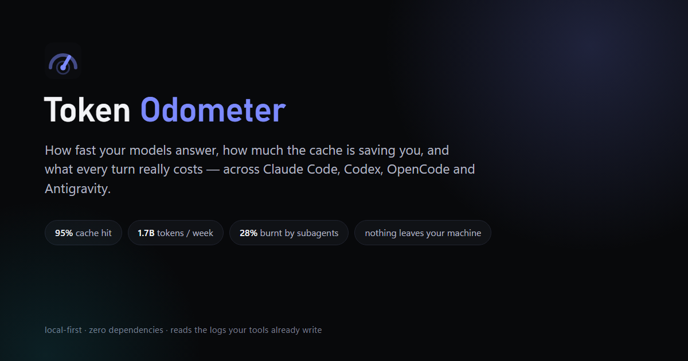
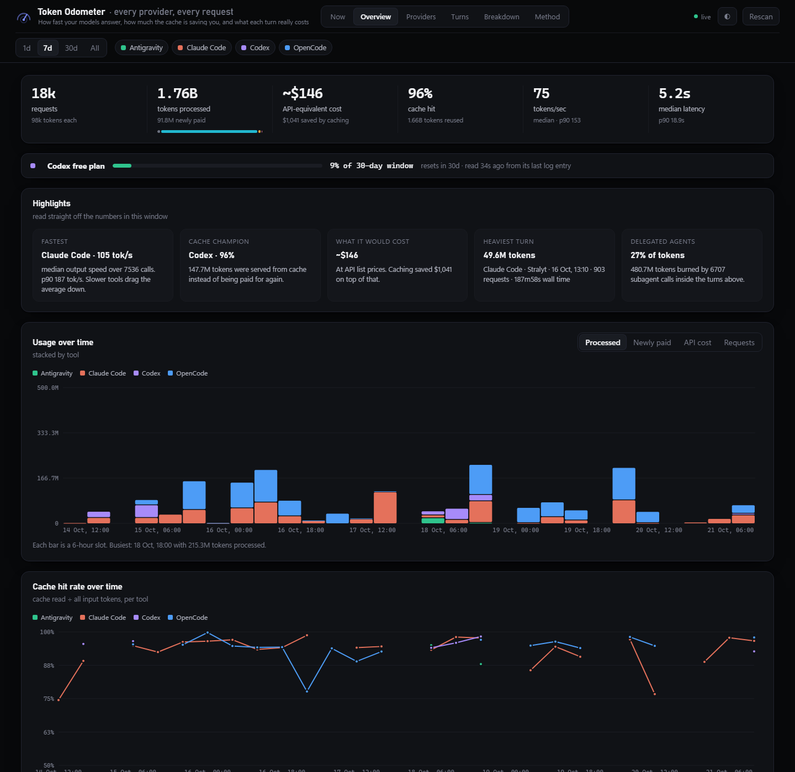
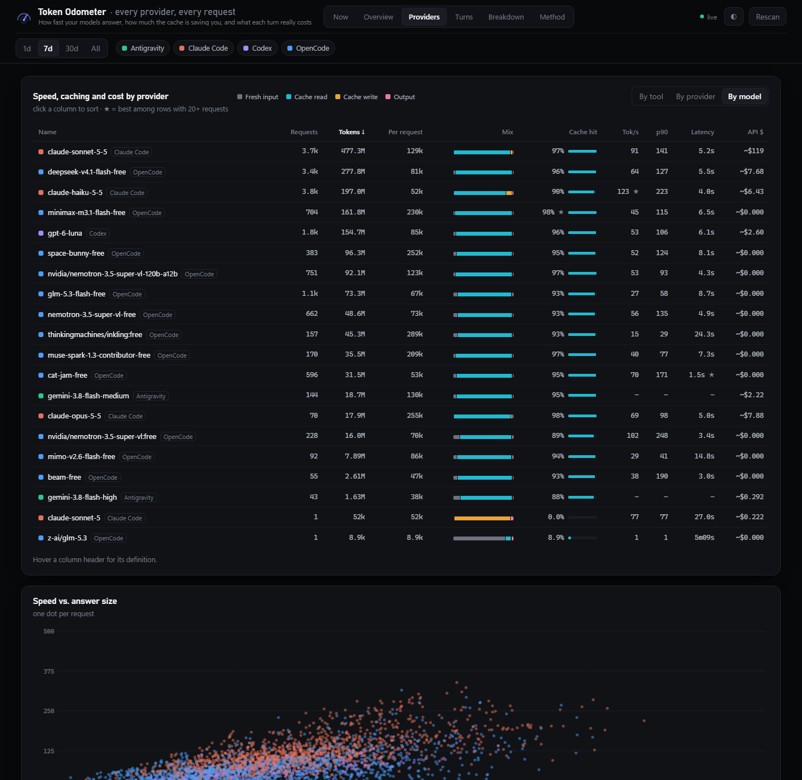

<p align="center">
  
</p>

<p align="center">
  <b>How fast your models answer, how much the cache is saving you, and what every turn really costs.</b><br>
  <sub>Local-first dashboard for Claude Code, Codex, OpenCode, Gemini CLI and Antigravity · zero dependencies · nothing leaves your machine</sub>
</p>

<p align="center">
  &nbsp;
  <sub>Node ≥ 24 · MIT · no npm dependencies · no account, no telemetry</sub>
</p>

---

You run a lot of AI across a lot of providers. Every harness has its own token counter, its own
idea of a "request", and its own way of telling you how much you have left. None of them add up.

**Tally** reads the session logs those tools already write, normalises every model call
into one record, and shows you the truth about your usage: tokens processed vs. tokens actually
paid for, cache hit rate over time, real output speed per provider and model, the cost of a turn,
and what your delegated agents burn.



## Quick start

Part of [Cairn](../../README.md): run it with `cairn tally`.

```bash
cairn tally serve          # dashboard on http://127.0.0.1:4747
cairn tally --line         # today in one line, for a status bar
cairn tally --last         # the latest turn: cost, tokens, cache hit
cairn tally --watch        # the same numbers in the terminal, live
```

Needs Node 24 or newer (it uses the built-in `node:sqlite`); there is nothing else to install.

## What you get

| View | The question it answers |
|---|---|
| **Now** | What is running right now, what it cost, and every request as it lands. |
| **Overview** | Tokens processed, tokens newly paid, cache hit rate, speed, latency, API-equivalent cost, plan limits — plus highlights read straight off the numbers. |
| **Providers** | Speed, cache hit, latency and cost per tool, provider or model, and a scatter of speed against answer size. |
| **Turns** | What one prompt of yours costs end to end: a histogram of turn size and the heaviest turns, expandable to every request inside them. |
| **Breakdown** | Where the tokens actually go — by tool call, project or model. |
| **Method** | How every number is measured, the health of each source, and the docs. |



## The numbers, honestly

- **Tokens processed** — fresh input + cache read + cache write + output, over every model call.
- **Tokens newly paid** — fresh input + cache write + output: what was *not* a cache hit.
- **Cache hit rate** — cache read ÷ all input tokens, over time, per tool.
- **Tokens/sec** — output tokens ÷ wall time of the call, counting calls with 30+ output tokens.
  Time to first token is included, so it reads lower than a provider's marketing number.
- **API-equivalent $** — tokens × list price, from T3 Code's rate table. What the same usage would
  cost on the API; a subscription does not bill this.
- **Turn** — everything the agent did to answer one prompt of yours, subagent calls included.

Where a value cannot be derived from the logs, the dashboard shows a dash instead of a guess.

## Where the data comes from

| Source | Read from |
|---|---|
| Claude Code | `~/.claude/projects/**/*.jsonl` |
| Codex | `~/.codex/sessions/**/*.jsonl` (+ plan limits) |
| OpenCode | `~/.local/share/opencode/opencode.db` (`session_message` + legacy `message`) |
| Gemini CLI *(experimental)* | `~/.gemini/tmp/*/chats/session-*.json[l]` — written from the documented format, not yet checked against a large real log set; reports no request duration, so no tok/s |
| Antigravity | `~/.gemini/antigravity/…` |

Missing a tool? A collector is one file — see the [collector contract](docs/CONTRACT.md).

All read-only. The server binds to `127.0.0.1` and never talks to the network. The only things it
writes are its own parse caches (`.cache/` inside this folder, or `$TALLY_CACHE`), plus short-lived copies of the OpenCode and
Antigravity SQLite files in your OS temp folder — those are deleted as soon as they are read.

## Verifying it

```bash
npm test                         # human-readable report
node src/tally/tools/selftest.mjs --json   # machine-readable
```

The harness checks every collector for: token sanity, no double counting, cache ratio in range,
duration bounds, plausible speeds, consistent turn grouping and sane timestamps. It exits non-zero
if anything fails — which is how the OpenCode duration bug was found in the first place.

The self-test only checks that numbers are internally consistent. To check that they are *right*,
`reconcile` compares them with counters the tools keep themselves:

```bash
npm run reconcile                # OpenCode + Codex (seconds)
node --no-warnings src/tally/tools/reconcile.mjs --claude   # also re-counts every raw Claude log by requestId (~1 min)
```

| Source | Independent counter | Result on the author's data |
|---|---|---|
| Claude Code | a separate recount of the raw logs keyed by `requestId` | 16,714 requests, 1.595B tokens, 0.000% apart |
| Codex | the per-thread cumulative total inside its own usage records | 38/38 sessions match, 0.00% apart |
| OpenCode | `session_v2` per-session totals | 0.05% apart; the rest is fork-replayed history, which OpenCode counts once per copy and this tool once |
| Antigravity | none exists | token fields are inferred from protobuf and labelled as such |
| Gemini CLI | none checked yet | experimental collector |

## Resource use

Built to stay out of the way: no polling timers, no database, no dependencies.

- **Idle:** 0% CPU and about 170 MB of RAM when no browser is connected. Each source is rescanned only when the OS reports a change in its log files (`fs.watch`), never on a timer.
- **Working with the dashboard open:** a few percent of one core, and only while your tools are actually writing logs. The server runs at below-normal priority, so it never competes with them.
- **How:** every parsed log is cached on disk and in memory, unchanged files are never re-read, and the merged data lives in typed arrays with one shared string table instead of one object per request.

## Project layout

```
server.mjs          static files + /api/data
store.mjs           watches each source's log files, rescans only what changed, serves compressed windows
collectors/*.mjs    one reader per tool, all normalised to the same request record
pricing.mjs         model list prices and cost estimation
web/                the dashboard (no build step, no dependencies)
tools/selftest.mjs  invariant checks over every collector
tools/reconcile.mjs totals checked against each tool's own counters
docs/               contract, research notes, design system, collector audit, FAQ
```

## Documentation

| | |
|---|---|
| [FAQ](docs/FAQ.md) | the questions a new user actually asks |
| [Design system](docs/DESIGN.md) | tokens, chart idioms, interaction rules |
| [Collector contract](docs/CONTRACT.md) | how to add a source |
| [Research notes](docs/research.md) | what each log format turned out to be |
| [Collector audit](docs/collector-audit.md) | every bug found, with evidence |

## License

MIT — see [LICENSE](LICENSE).

